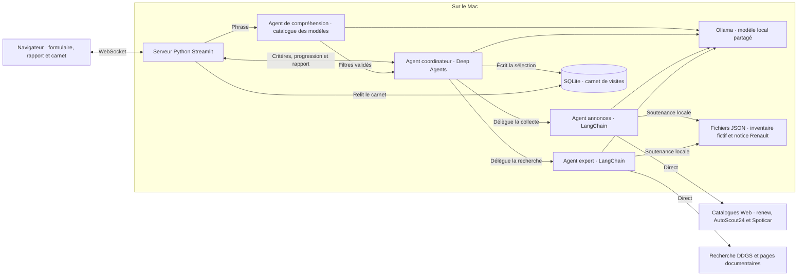
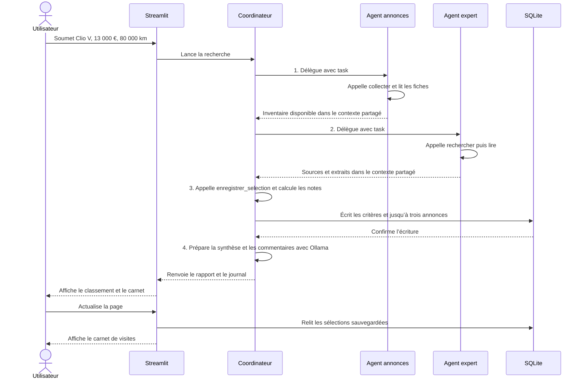

# Architecture de Carnet auto

## 1. Qui communique avec qui ?

L’interface et le backend appartiennent à la même application Streamlit. Le navigateur transmet les événements du formulaire et reçoit les mises à jour via WebSocket. Python exécute les outils, calcule les notes et interroge SQLite. Ollama fournit l’inférence aux agents.

## 2. Que se passe-t-il pendant une recherche ?

Le code fixe l’ordre des délégations. Ollama émet les appels aux outils autorisés pour chaque étape. Le calcul Python applique les filtres, cherche des comparables dans l’inventaire et classe jusqu’à dix annonces. Le coordinateur sauvegarde jusqu’à trois annonces avant de composer le rapport.

## 3. Quel mode utilise quelles données ?

| Mode | Sources | Agents et carnet |
|---|---|---|
| **Catalogues en direct** | renew, AutoScout24, Spoticar, recherche Web et pages ouvertes | Trois agents avec Ollama. Sélection écrite dans SQLite. |
| **Soutenance locale** | Sept annonces fictives et un extrait du manuel Renault dans le projet | Trois agents avec Ollama. Sélection écrite dans SQLite. Fonctionne sans Internet. |
| **Démonstration** | Les sept annonces fictives | Classement Python seul. La recherche ne crée aucune sélection. |
